# uts-websederhana
toko buku komplit

link website: https://choilrul48-create.github.io/uts-websederhana/

link youtube: https://youtu.be/OPi_ctO15jw?si=1xh6zqX6o-kP_C2v

Membuat menu login

a.	Pesiapan pada html
 
 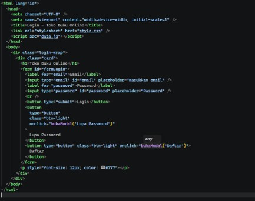
 
 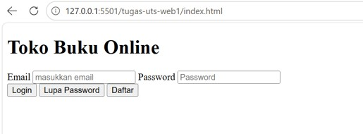

b.	Penambahan style css

 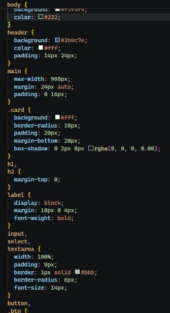

  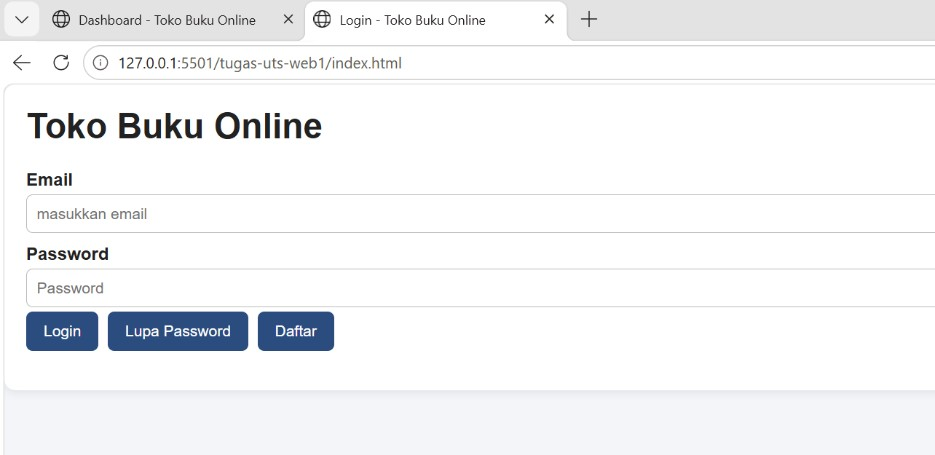

c.	Penambahan pop up jika email dan kata sandi salah pada javascript

 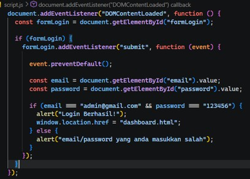

  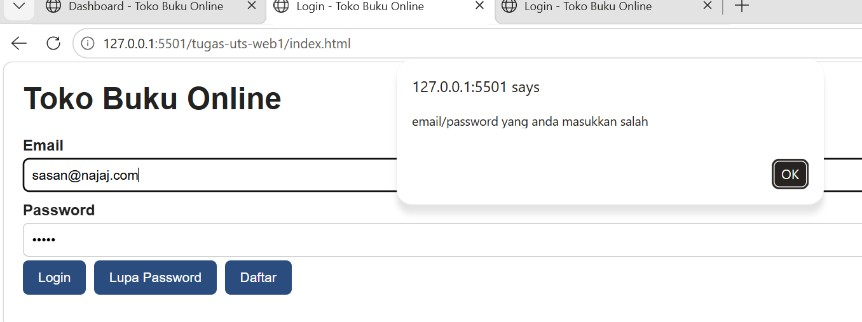

MEMBUAT MENU DASTBOARD

1.	Penambahan menu

 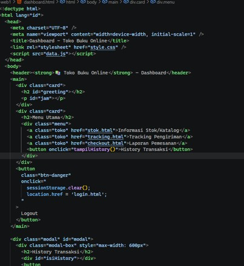
  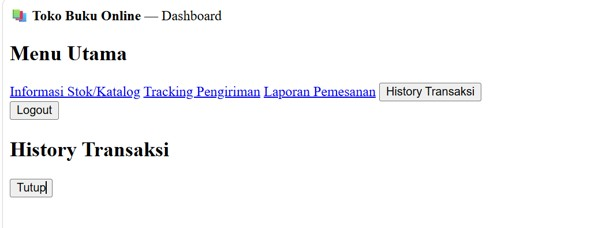

 

2.	Menambahkan style css

  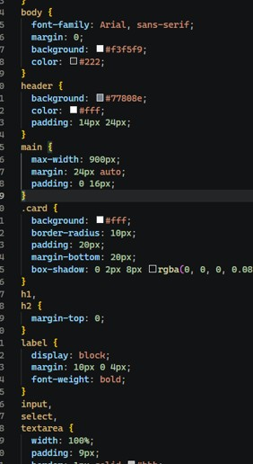

   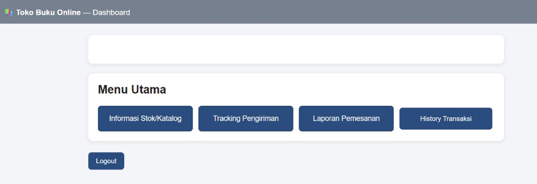
3.	Penambahan waktu secara real time 

 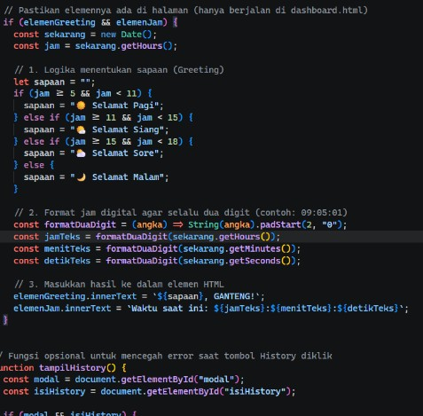

 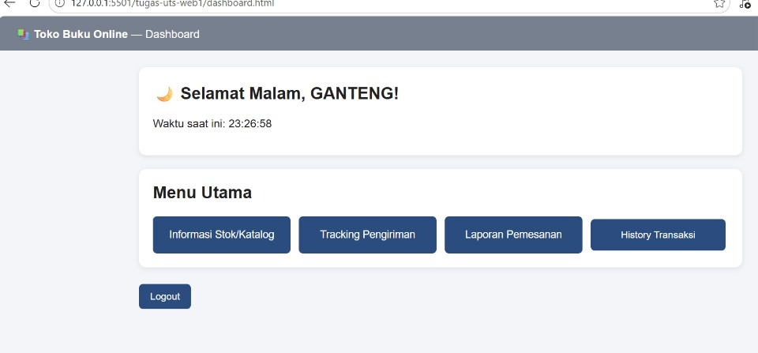
Informasi Stok/Katalog (stok.html)

a.	Membuat html stock barang dan  proses sebelum penanbahan  stock barang

 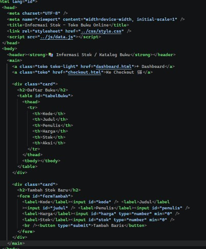

 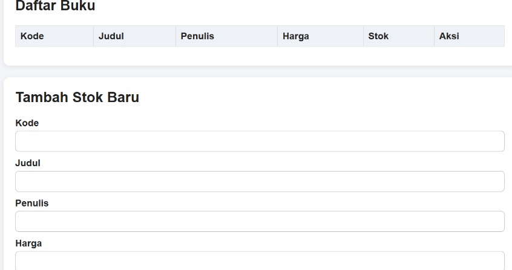

b.	menambahkan data stock barang dari javascript

 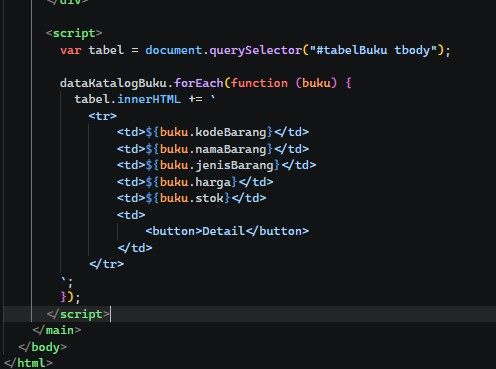

 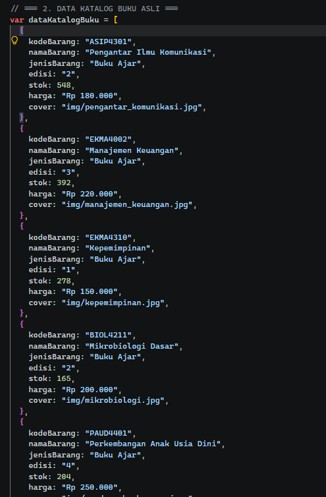

 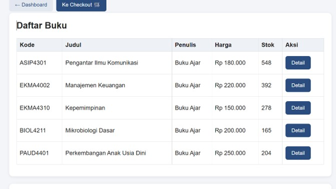

Halaman Pemesanan (checkout.html)

1.	Persiapan html 

 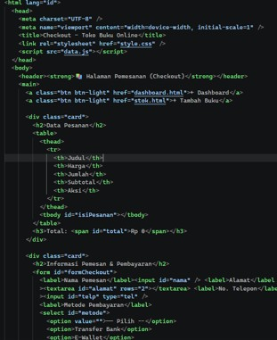

 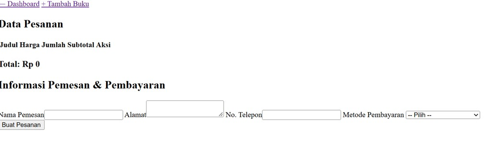

2.	Penanbahan style css

 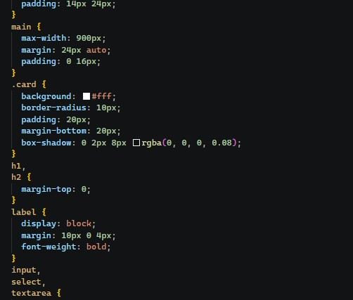

 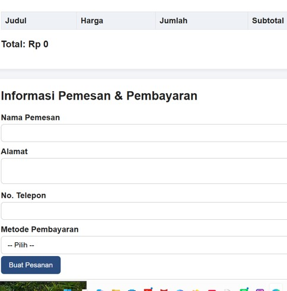

Informasi Pengiriman (tracking.html)

1.	Persiapan html

 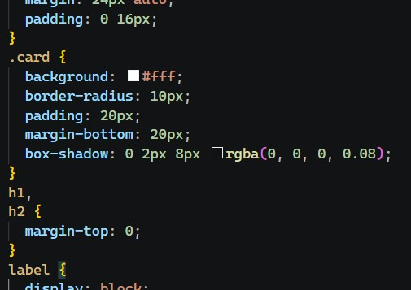

 

2.	Penambahan css
  
 

 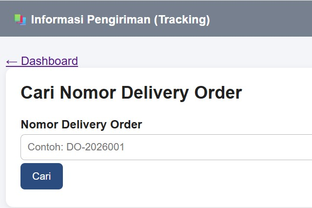
